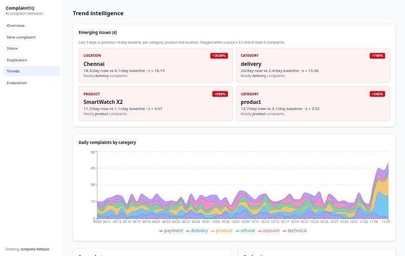

<div align="center">
  <h3><code>aakash@github ~/AI-Powered-Customer-Complaint-Classification-Resolution-System $ ./banner.sh</code></h3>
  
  <p><code>Classify, prioritise, route and resolve customer complaints with explainable AI</code></p>

  <br><br>

  <h3><code>aakash@github ~/AI-Powered-Customer-Complaint-Classification-Resolution-System $ cat about.txt</code></h3>
  <p>A support platform that reads each complaint and does the triage. It predicts the category, sentiment, emotion and priority, extracts order IDs, amounts, products and places, routes the complaint to a department, and drafts a reply grounded in approved playbooks for staff approval.
  It groups duplicate complaints, flags emerging spikes by product or city, and learns from agent corrections. Every decision comes with the reason behind it.
  A landing page at <code>/</code> shows the product; the working console lives at <code>/app</code>. Design rules: <a href="DESIGN.md">DESIGN.md</a>.
  Details: <a href="docs/DOCUMENTATION.md">documentation</a> · <a href="data/README.md">dataset & splits</a> · evaluation in <code>backend/artifacts/</code>.</p>

  <br><br>

  <h3><code>aakash@github ~/AI-Powered-Customer-Complaint-Classification-Resolution-System $ ./preview.sh</code></h3>
  

  <br><br>

  <h3><code>aakash@github ~/AI-Powered-Customer-Complaint-Classification-Resolution-System $ ./stack.sh</code></h3>
  <p>
    &nbsp;
    &nbsp;
    &nbsp;
    &nbsp;
    &nbsp;
    &nbsp;
    &nbsp;
    &nbsp;
    &nbsp;
    &nbsp;
    
  </p>

  <br><br>

  <h3><code>aakash@github ~/AI-Powered-Customer-Complaint-Classification-Resolution-System $ ./run.sh</code></h3>
</div>

Needs Python 3.12 with [uv](https://docs.astral.sh/uv/), Node 20+, and PostgreSQL. Without `DATABASE_URL`, the backend falls back to SQLite. Without `GEMINI_API_KEY`, drafts use a template.

```bash
git clone https://github.com/Aakashxnoir/AI-Powered-Customer-Complaint-Classification-Resolution-System.git
cd AI-Powered-Customer-Complaint-Classification-Resolution-System

# backend (Python deps, CPU PyTorch, spaCy model)
cd backend && uv sync && cp .env.example .env && cd ..
# optional PostgreSQL: createdb complaints, then set DATABASE_URL in backend/.env

# data, models, evaluation, demo data (~10 min on CPU)
backend/.venv/bin/python ml/generate_data.py
backend/.venv/bin/python ml/train.py
backend/.venv/bin/python ml/evaluate.py
backend/.venv/bin/python ml/seed_db.py --reset

# API on :8000
cd backend && .venv/bin/uvicorn app.main:app --port 8000

# landing page on :5173, console on :5173/app (second terminal)
cd frontend && npm install && npm run dev
```

```bash
cd backend && uv run pytest -q
```

**Deploy.** The `Dockerfile` builds the frontend and serves landing page, console and API from one container on port 7860 (needs about 4 GB RAM for the three models; Hugging Face Spaces' free Docker tier fits). The database starts empty: submit complaints in the console or upload a CSV. `ml/seed_db.py` is an optional dev tool that loads a synthetic demo stream. Environment: `GEMINI_API_KEY` (optional), `DATABASE_URL` (optional, SQLite by default), `ALLOWED_HOSTS` (default `*` in the image).

<div align="center">
  <br>
  <h3><code>aakash@github ~/AI-Powered-Customer-Complaint-Classification-Resolution-System $ ./links.sh</code></h3>
  <p>
    <a href="https://aakash-portfolio-navy.vercel.app"></a>&nbsp;
    <a href="https://github.com/Aakashxnoir"></a>
  </p>
  <br>
</div>
